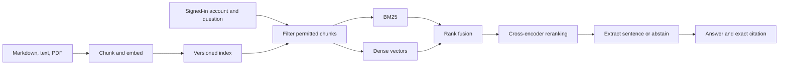

# GroundedDocs

GroundedDocs answers questions from a small document library or a document you upload for the current session, and shows the exact evidence it used. It compares BM25 keyword search, dense vector search, rank-fused hybrid search, and cross-encoder reranking. Each signed-in demo account can retrieve only its permitted bundled documents; uploads are isolated to the current app session.

**Status:** locally built, benchmarked, and [published on GitHub](https://github.com/saidarshan20/GroundedDocs). Streamlit deployment is intentionally deferred while the project owner tests and studies the code. A live URL and screenshots can be added later. The [build guide](GroundedDocs.md) explains the full design; [PROGRESS.md](PROGRESS.md) records the current handoff point.

## Try it locally

Install Python 3.11, then run from this repository's root:

```powershell
py -3.11 -m venv .venv
.\.venv\Scripts\python.exe -m pip install -r requirements.txt
.\.venv\Scripts\python.exe -m scripts.setup_demo_secrets
.\.venv\Scripts\python.exe -m streamlit run streamlit_app.py
```

On macOS/Linux, replace the first two Python paths with `python3.11 -m venv .venv` and `.venv/bin/python`. The first app launch downloads two free ONNX models into the ignored `.model-cache/` folder. No API key is needed. The local secret generator refuses to overwrite an existing secrets file.

After pulling code changes, stop the running Streamlit process with `Ctrl+C` and start it again with the command above. A browser refresh alone may leave Python modules or cached model objects from the previous version in memory.

| Synthetic account | Password | Access |
| --- | --- | --- |
| guest | `guest-demo-2026` | 12 shared documents |
| alice | `alice-demo-2026` | shared documents and 9 Alice documents |
| bob | `bob-demo-2026` | shared documents and 9 Bob documents |

These credentials and documents are intentionally public. They demonstrate server-side filtering; they do **not** secure confidential material. Try “When is Alice's prototype review?” as Alice, then Bob to see the access difference. Try “How many pages may a guest print per visit?” for a PDF page citation.

### Test your own document

After signing in, choose a text-based `.pdf`, `.md`, or `.txt` file under 5 MB and click **Use this document**. The default **Search scope** is **Uploaded document only**; switch to **Uploaded document + sample library** if you want both. Try the safe [example file](assets/upload_example.txt) and ask “When does the violet ferry leave Harbor Nine?” The answer should say **6:40 a.m. every Tuesday** and cite `upload_example.txt`. Click **Clear uploaded document** or log out to remove it from search. Only one upload is active at a time, and files over 120 passages, scanned PDFs, encrypted PDFs, and non-UTF-8 text are rejected. The file is processed in server memory for this app session, never written into the repository or the benchmark.

For a text-based PDF cheat sheet, the uploader uses the page layout to keep visually separated heading and command groups as individual passages. Answers can therefore show a short heading and command instead of a whole page. After pulling a change to PDF handling, stop and restart Streamlit, click **Use this document** again, and rerun your question so the upload is re-indexed.

## How it works



The committed index holds 59 passages from 30 original fictional documents: 12 shared, 9 Alice-only, and 9 Bob-only. Access grants are in `corpus/manifest.jsonl`; search filters by principal before scoring or displaying any result. An uploaded document is chunked and embedded with the same pinned model, then kept only in that browser session's app memory. The answer is a verbatim source sentence, never generated prose. A development-only reranker threshold controls abstention. Rebuild the committed index after any bundled corpus, grant, chunking, or embedding-model change.

## Measured results

The question set has 60 authored labels: 10 answerable and 5 negative development questions, plus 30 answerable and 15 negative held-out questions. The table below uses only the held-out bundled corpus; it does not measure uploaded files. Recall counts a question once if a relevant **document** appears in the top k chunks. Timings include retrieval and answer selection over three warm passes, excluding model loading and index construction. p95 uses the nearest-rank method.

| Mode | Recall@5 | Recall@10 | p95 latency | Answer coverage | Negative abstention | External API cost/query |
| --- | ---: | ---: | ---: | ---: | ---: | ---: |
| BM25 | 1.000 | 1.000 | 0.9 ms | 1.000 | 0.067 | $0.00 |
| Dense | 1.000 | 1.000 | 40.1 ms | 1.000 | 0.000 | $0.00 |
| Hybrid | 1.000 | 1.000 | 10.5 ms | 1.000 | 0.000 | $0.00 |
| Reranked hybrid | 1.000 | 1.000 | 455.2 ms | 1.000 | 0.800 | $0.00 |

The 30 non-abstaining reranked answers had **30/30 citation correctness** on manual review. This means their cited excerpts directly supported the answers on this fictional set; it is not a general accuracy claim. The reranker improved rejection of negative questions here but added substantial latency. All retrieval modes reached the same recall on this easy, small corpus, so this benchmark does **not** show a recall gain from hybrid retrieval or reranking. Negative abstention remains imperfect, including some unsupported answers. External API cost excludes local or hosted CPU, electricity, and paid infrastructure.

Measured with Python 3.11.15 on Windows, an Intel64 Family 6 Model 154 CPU, and 15.68 GB RAM. The two ONNX model revisions are pinned in `config.json`. See [benchmark.md](results/benchmark.md) for the generated summary and [benchmark.json](results/benchmark.json) for per-question outputs, index fingerprint, and precise metrics. Manual judgments are in [citation_judgments.jsonl](labels/citation_judgments.jsonl); [rubric.md](labels/rubric.md) defines the review rule.

## Reproduce

```powershell
.\.venv\Scripts\python.exe -m scripts.create_sample_corpus
.\.venv\Scripts\python.exe -m scripts.build_index
.\.venv\Scripts\python.exe -m scripts.tune_threshold
.\.venv\Scripts\python.exe -m pytest -q
.\.venv\Scripts\python.exe -m scripts.run_benchmark
```

The corpus generator writes the same original Markdown/PDF samples and labels each time. The index builder saves embeddings and a corpus fingerprint. `tune_threshold` uses only development labels. If an answer changes, its manual citation judgment hash will stop matching and the benchmark will mark citation correctness as pending until it is reviewed again.

## Limits and deployment

This is a portfolio-scale demo, not a production document security service. Its shared demo passwords are public; uploads are temporary and it has no OCR, durable live edits, or LLM synthesis. The benchmark corpus is small and deliberately answerable, so document recall is saturated. For a harder follow-up, add paraphrases and competing documents before making stronger quality claims. If the app is later hosted, uploading a file sends it to that host; use only documents appropriate for that service.

The intended free live host is Streamlit Community Cloud. **Deployment is deferred at the owner's request.** When ready, choose the [public repository](https://github.com/saidarshan20/GroundedDocs), `streamlit_app.py` as the entrypoint, and Python 3.11 in Cloud, then paste the local `.streamlit/secrets.toml` content into Cloud's Secrets setting. The public app may hibernate and wake on the next visit. Never commit `.streamlit/secrets.toml`, `.venv/`, `.python/`, or `.model-cache/`.

## License

Code and fictional sample data are released under the [MIT License](LICENSE).
