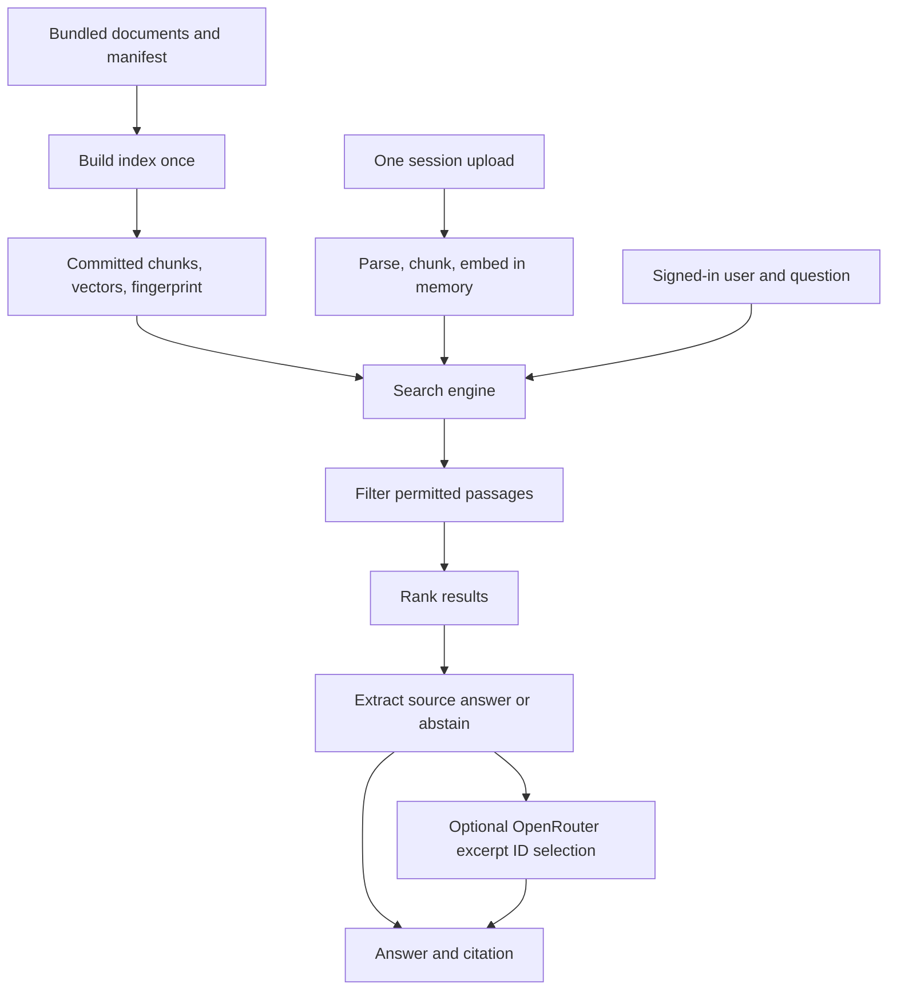
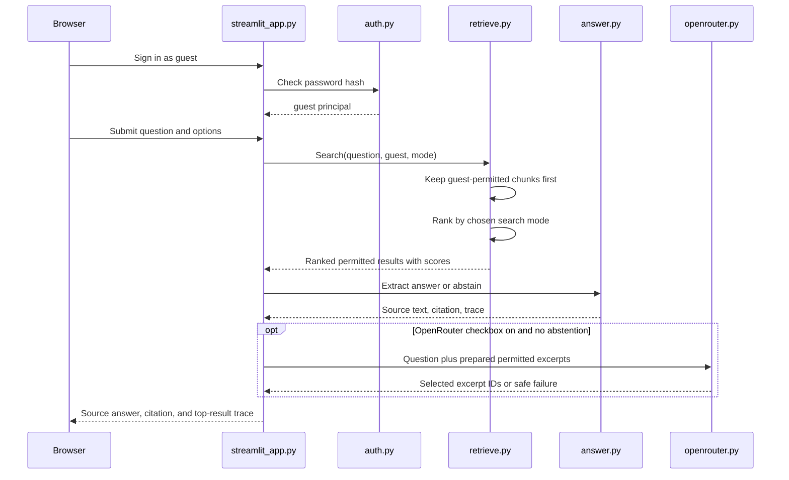

# GroundedDocs: a beginner-to-advanced walkthrough

This guide explains the **current code**, from the first browser click to the cited answer. Read it from top to bottom once. Then use the [file reading order](#which-files-should-i-read-first) to explore the source. The [README](README.md) is the quick start, [GroundedDocs.md](GroundedDocs.md) is the original build plan, and [PROGRESS.md](PROGRESS.md) is the handoff tracker.

## 1. The project in plain English

GroundedDocs is a small document question-answering app. You sign in, optionally upload a PDF, Markdown, or TXT file, and ask a question. The app searches only documents that your demo account can access, then shows a short answer copied from a document with a citation. You can compare four search methods and optionally let OpenRouter **choose which source excerpts to show**. Even with OpenRouter enabled, the words displayed as the answer come from the retrieved documents, not from the model's own prose.

Think of it as a librarian with two jobs: **find the right page** and **point to the exact line**. The optional AI organizer can choose and order lines, but the app supplies the lines and checks their IDs.

This is a **question form**, not a continuing chat. Each submitted question is searched independently; previous questions are not sent as conversation history.

## 2. Words you will see throughout the repo

| Word | Beginner meaning | In this project |
| --- | --- | --- |
| Corpus | The documents available to search | The 30 fictional documents listed in `corpus/manifest.jsonl` |
| Manifest | A list describing each document | Its ID, title, file path, and permitted users |
| Section | A part of a file | A Markdown heading, PDF page/block, or TXT text section |
| Passage or chunk | A smaller piece of searchable text | Usually at most 180 words, with 40 words of overlap when a long section is split |
| Index | Prepared data that makes search possible | `index/chunks.jsonl`, `index/embeddings.npy`, and `index/build_info.json` |
| Embedding | Numbers representing a passage's meaning | A 384-number vector from the pinned local embedding model |
| Principal | The signed-in account name | `guest`, `alice`, or `bob` |
| Retrieval | Finding likely passages | BM25, dense, hybrid, or reranked search |
| Reranker | A model that checks question/passage pairs more carefully | The local cross-encoder used after hybrid search |
| Abstain | Say the evidence is insufficient | The app shows a fixed message without a citation |
| Citation | A pointer back to evidence | Document title, page or section, and chunk ID |
| Session state | Memory for one open app session | Login and one uploaded document's passages/vectors |

**File size and passage count are different.** A PDF can be under the 5 MB upload limit but still produce many passages. Uploads are limited to 256 passages so indexing cannot grow without bound.

## 3. Two timelines: preparation and answering

The app has a **build-time path** and a **question-time path**. You normally run the build-time path only when changing the bundled fictional documents or embedding settings. Every question goes through the question-time path.



### Before a user asks anything: build the bundled index

1. [scripts/create_sample_corpus.py](scripts/create_sample_corpus.py) creates the original fictional sample documents and labeled questions. The included data is deliberately public and synthetic.
2. [corpus/manifest.jsonl](corpus/manifest.jsonl) lists **30** bundled documents: 12 shared by all accounts, 9 Alice-only, and 9 Bob-only. A file sitting in `corpus/docs/` is **not automatically bundled**; it needs a manifest entry and an index rebuild. This matters for PDFs you place there yourself.
3. [grounded_docs/ingest.py](grounded_docs/ingest.py) validates the manifest and reads each listed file. It splits long text into passages, attaches metadata such as `allowed_users` and page number, and gives each passage a stable `chunk_id`.
4. [grounded_docs/models.py](grounded_docs/models.py) loads pinned local ONNX model snapshots. The embedding model converts every passage into a numerical vector.
5. [scripts/build_index.py](scripts/build_index.py) runs the build. It writes **59** bundled passages to `index/chunks.jsonl`, their 384-dimensional vectors to `index/embeddings.npy`, and version/fingerprint information to `index/build_info.json`.
6. On startup, `load_index()` checks the current corpus and configuration against that fingerprint. If they no longer match, it stops and asks you to rebuild; it does not quietly search an outdated index.

The bundled index is committed to Git. A user's upload follows a separate in-memory path and is **not** added to this index or the benchmark.

One real index record, shortened to the important fields, looks like this:

```json
{
  "chunk_id": "pub01:s2-policy:001",
  "doc_id": "pub01",
  "title": "Visitor check-in",
  "page": null,
  "section": "s2-policy",
  "text": "Visitors must sign in at the lobby desk and wear a blue visitor badge while inside Cedarline Cooperative offices.",
  "allowed_users": ["guest", "alice", "bob"]
}
```

`chunk_id` locates one passage; `doc_id` names its document. `page` is used for PDFs and `section` for text/Markdown. Each line in `chunks.jsonl` has a matching vector row at the same position in `embeddings.npy`. `text_sha256` (omitted above) checks the passage text, while the broader corpus fingerprint checks whether the built index still matches its source files and settings.

## 4. The full route when someone asks a question

Here is the runtime path. Use the question **“How many pages may a guest print per visit?”** as a concrete example. The exact scores depend on the models and text; the steps do not.



### Step 1 — Streamlit runs the page

[streamlit_app.py](streamlit_app.py) is the entry point. Streamlit reruns this script from top to bottom when a widget action is submitted. `st.session_state` preserves the current account and uploaded document across those reruns. The large, shared model/index objects are cached with `st.cache_resource`; they are not rebuilt for each click.

At startup, the app reads [config.json](config.json). On the first search or upload, it checks the committed index and loads the local embedding and reranking models; later actions can reuse the cached engine. The cache key includes selected source files, configuration, and index build information. After code changes, restarting Streamlit is still the clearest way to remove old Python imports and session data.

### Step 2 — Sign in

The login form sends the chosen demo account and typed password to [grounded_docs/auth.py](grounded_docs/auth.py). Locally, `demo_hashes()` reads this project's ignored `.streamlit/secrets.toml`; on a host without that file it uses Streamlit secrets. `authenticate()` uses bcrypt to compare the typed password with the stored hash. Only the account name, called the **principal**, is put in session state. The password is not stored as the session identity.

These are **public demo accounts**, not real identity protection. Their passwords are in the README so anyone can try the access-filtering feature.

### Step 3 — Decide what is searchable

If there is no upload, the question searches the bundled fictional library. If a file was uploaded, the default radio choice is **Uploaded document only**. The other choice searches the upload **plus** the bundled library. `SearchEngine.with_upload()` creates a search view for this app session; it does not change the shared committed index.

For the example question, `guest` can search shared documents such as the sample printing-policy PDF. Alice-only and Bob-only documents are not eligible.

### Step 4 — Filter access **before** ranking

`SearchEngine.search()` in [grounded_docs/retrieve.py](grounded_docs/retrieve.py) first makes a list of chunk positions whose `allowed_users` contains the signed-in principal. BM25 and vector scoring then work on that permitted list. This order matters: an unauthorized document cannot become a result, citation, or item in the visible trace simply because it matches the question well.

An upload's chunks also have an `allowed_users` tag, and the upload exists only in that browser session's `st.session_state`. Two people using the same public `guest` password in different sessions do not share uploaded passages.

### Step 5 — Rank the permitted passages

The **Retrieval mode** selector chooses one of four paths:

1. **BM25:** keyword search. It rewards matching terms such as “guest,” “print,” and “pages.” It is fast but can miss a paraphrase.
2. **Dense:** the local embedding model turns the question into a vector. The code compares it with stored passage vectors using cosine similarity, so wording can differ.
3. **Hybrid:** take up to 20 candidates from each list and combine their **ranks** with reciprocal rank fusion (RRF). A passage near the top of both lists gets a stronger combined rank. The formula is `1 / (60 + rank)` for each list it appears in.
4. **Reranked:** start with hybrid candidates, then the local cross-encoder reads the question together with each shortlisted passage and sorts by its score. This is the default mode and usually takes longer.

The search returns up to 10 results to the app. Each result contains a chunk plus scores such as `bm25`, `dense`, `rrf`, and (for reranked mode) `reranker`. The **Top results and scores** expander shows up to five of them. These scores help inspect ranking; they are not probabilities that the answer is true.

### Step 6 — Decide whether to answer

[grounded_docs/answer.py](grounded_docs/answer.py) receives the ranked results. In reranked mode, it compares the top score to `abstention_threshold` in `config.json`. If the score is below that cutoff, or there are no results, it returns **“I couldn't find enough evidence in documents you can access.”** with no citation. The cutoff was chosen using development questions, not the held-out benchmark questions.

Otherwise, it examines the top three chunks. It splits their text into sentence-like pieces and favors a sentence containing the question's useful words. For certain short uploaded headings, an exact heading can win a close reranker tie. The answer is copied from the selected chunk; it is **not newly written prose**. The citation includes the chunk ID, title, and page or section. The supporting excerpt is the original chunk text.

For the sample question, a valid citation can point to `pub12:page-1:001` and **page 1** of the bundled PDF. A chunk ID is a locator, not an answer by itself.

The threshold is applied only when the selected mode is `reranked`. Other modes can still return an irrelevant extractive answer; use them mainly to compare retrieval behavior.

### Step 7 — Optionally let OpenRouter organize excerpts

The **Organize answer with OpenRouter** checkbox starts off. When it is on **and the local answer did not abstain**, [grounded_docs/openrouter.py](grounded_docs/openrouter.py) considers the top five permitted results. It prepares up to three short sentence-like excerpts from each, gives them IDs such as `S1`, and sends the question plus at most 15 excerpts to the free Nemotron model through OpenRouter. The model is asked to return only one to three IDs in useful order. Reasoning is disabled for this small selection task.

The app validates the returned IDs and displays the **locally held text** associated with them. It constructs citations from local chunk metadata. Model-written claims are never used as answer text. If OpenRouter returns an HTTP error, invalid IDs, no usable answer, or runs out of output tokens, the app explains the safe error and shows the local extractive answer. An abstention never triggers an API call.

The key comes from `OPENROUTER_API_KEY` in the environment, ignored `.env`, or a top-level Streamlit secret. Enabling this option **sends the question and selected document excerpts to an external service**. The free endpoint is unsuitable for confidential or personal material. The app sends excerpts, not the whole uploaded file as a separate PDF request, but excerpts from a short file may cover much of it.

### Step 8 — Render the result

Finally, `streamlit_app.py` shows the answer, its source label, and the top-result trace. A local answer also shows its full supporting chunk in a text area. If OpenRouter chose several excerpt IDs, each displayed excerpt has its own citation. The benchmark panel below the question form describes the **bundled local path only**; it does not measure your upload or the OpenRouter step.

## 5. What happens when you upload a file?

An upload is processed only after **Use this document** is clicked:

1. [grounded_docs/uploads.py](grounded_docs/uploads.py) checks the signed-in principal, file extension, nonempty content, and 5 MB byte cap. The displayed filename is sanitized.
2. TXT and Markdown must be UTF-8. Markdown is divided at headings. A text-based PDF is read with `pypdf` page by page; layout-aware extraction divides visually separated text blocks. Scanned/image-only and encrypted PDFs are not supported.
3. Long blocks become passages using the configured 180-word size and 40-word overlap. Short PDF blocks stay intact so a heading and command can remain together. No passage crosses a PDF page. The 256-passage cap is checked here.
4. Every passage gets a document ID based on the file bytes, a section/page locator, a text hash, the current account grant, and `origin: session_upload`.
5. `SearchEngine.embed_passages()` computes and normalizes vectors with the **same embedding model** used by the bundled index. The passage list and vectors go into this session's memory. They are not written to the repo or benchmark.
6. **Clear uploaded document** removes them from session state. **Log out** clears the session state. After a Streamlit restart, you must upload again.

The 15-page PDF tested during development generated 174 passages and took about 31 seconds to embed on the measured local machine. This wait happens at upload time; it is separate from question search time.

## 6. Which files should I read first?

Read these in order. The **priority** here means learning priority, not runtime execution order.

| Reading priority | File | Why it matters |
| --- | --- | --- |
| 1 | [streamlit_app.py](streamlit_app.py) | The whole user journey and calls into the other modules |
| 2 | [grounded_docs/retrieve.py](grounded_docs/retrieve.py) | Access filtering and all four search modes |
| 3 | [grounded_docs/answer.py](grounded_docs/answer.py) | Local answer, abstention, and citation choice |
| 4 | [grounded_docs/uploads.py](grounded_docs/uploads.py) | Your PDF/TXT/Markdown upload path |
| 5 | [grounded_docs/auth.py](grounded_docs/auth.py) | Demo login and secrets selection |
| 6 | [grounded_docs/openrouter.py](grounded_docs/openrouter.py) | Optional external excerpt selection and fallback |
| 7 | [grounded_docs/ingest.py](grounded_docs/ingest.py) | How the bundled index is prepared and checked |
| 8 | [grounded_docs/models.py](grounded_docs/models.py) and [config.json](config.json) | Which local models/settings are used |
| 9 | [grounded_docs/evaluate.py](grounded_docs/evaluate.py), [tests/](tests/), and [results/benchmark.md](results/benchmark.md) | How correctness and speed are checked |

Other useful files: [corpus/manifest.jsonl](corpus/manifest.jsonl) says who can read each bundled document; [index/build_info.json](index/build_info.json) records the index fingerprint; [requirements.in](requirements.in) lists direct packages while [requirements.txt](requirements.txt) pins the full environment; [PROGRESS.md](PROGRESS.md) records completed work and deferred deployment. `GroundedDocs.md` is a **build plan**, whereas this file describes the **working implementation**.

## 7. How to explore it yourself, step by step

Open PowerShell in this directory. If the existing virtual environment is ready:

```powershell
.\.venv\Scripts\python.exe -m streamlit run streamlit_app.py
```

Then try this short learning path:

1. Sign in as `guest` with the published demo password from [README.md](README.md). Ask **“How many pages may a guest print per visit?”** Leave OpenRouter off. Read the answer, page citation, supporting excerpt, and **Top results and scores**.
2. Change **Retrieval mode** among BM25, dense, hybrid, and reranked. Ask the same question. Compare result order and scores; the modes do not share one universal score scale.
3. Sign out. Ask **“When is Alice's prototype review?”** as `alice`, then as `bob`. Check that Bob's trace does not show Alice's restricted document. These accounts are only a demo of filtering.
4. Upload [assets/upload_example.txt](assets/upload_example.txt) and choose **Uploaded document only**. Ask **“When does the violet ferry leave Harbor Nine?”** Check that the citation names the upload. Clear it and ask again.
5. If you want to test OpenRouter, turn on its checkbox with only the public fictional examples. Watch that the displayed wording is still source text. Turn it off to see the local baseline.
6. Run the tests:

```powershell
.\.venv\Scripts\python.exe -m pytest -q
```

The most instructive tests are [test_access.py](tests/test_access.py) for restricted documents, [test_uploads.py](tests/test_uploads.py) for PDFs and session isolation, [test_citations.py](tests/test_citations.py) for source copying, [test_openrouter.py](tests/test_openrouter.py) for ID validation, and [test_app.py](tests/test_app.py) for the UI route. The full suite had **38 passing tests** when this guide was written.

## 8. How the benchmark fits in

[labels/questions.jsonl](labels/questions.jsonl) contains 60 authored questions. Fifteen development questions help select the reranker abstention threshold; 45 held-out questions measure the finished local path. [scripts/tune_threshold.py](scripts/tune_threshold.py) writes the cutoff to `config.json`. [scripts/run_benchmark.py](scripts/run_benchmark.py) calls [grounded_docs/evaluate.py](grounded_docs/evaluate.py), which runs the four modes and writes [results/benchmark.json](results/benchmark.json) and [results/benchmark.md](results/benchmark.md).

The measures answer different questions:

| Measure | What it asks |
| --- | --- |
| Recall@5 | Did a relevant document appear among the first five retrieved chunks? |
| p95 latency | How long did the slower 5% of measured local queries take? |
| Answer coverage | How often did the app give an answer rather than abstain on answerable questions? |
| Negative abstention | How often did it correctly refuse negative questions? |
| Citation correctness | Did a human reviewer judge the cited excerpt to support the exact answer? |

The benchmark is intentionally narrow: small fictional documents, the committed local index, and **no uploaded files or OpenRouter calls**. [labels/rubric.md](labels/rubric.md) explains why a copied sentence can still be irrelevant; exact copying alone is not proof of a good answer. Current measured figures are in the README rather than being promises for other documents.

## 9. Advanced design choices and honest limits

- **Filter first:** `retrieve.py` restricts the candidate pool before keyword scoring, vector scoring, reranking, answer extraction, and display.
- **Stable build:** the manifest, source bytes, model revision, and chunk settings feed an index fingerprint. This catches a stale committed index.
- **Pinned local models:** their exact revisions are in `config.json`; `.model-cache/` stores downloaded model files locally and is ignored by Git.
- **Shared versus private memory:** the bundled index/model cache can be shared safely; each upload's passages and vectors live in that session state. A lock protects model inference calls shared by concurrent sessions.
- **Citations guarantee provenance, not truth:** the text shown exists in a permitted chunk, but the document may be wrong, retrieval may miss a better passage, and an extracted sentence may not fully answer the question.
- **Abstention is imperfect:** the threshold came from a small development set. In BM25/dense/hybrid mode it is not applied at all. Read the supporting excerpt before trusting an answer.
- **PDF extraction is text-based:** scanned PDFs need OCR, which is not implemented. Complex columns or tables can still be extracted awkwardly.
- **OpenRouter is optional and external:** its free endpoint can fail or rate-limit, and selecting it sends the question and prepared excerpts outside the app. The local path still works without an API key.
- **Public demo security is limited:** the published passwords let anyone use the fictional accounts. Do not treat them as protection for private data. The app is a portfolio-scale demonstration, not a production document-security system.

If you remember one route, remember this: **sign in → choose source → filter allowed passages → rank them → extract or abstain → optionally select source excerpt IDs with OpenRouter → display original text plus citations**.
